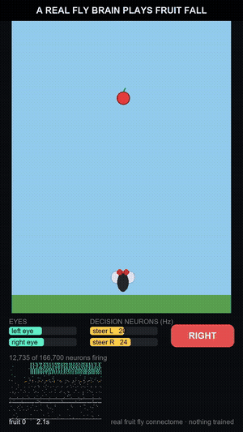
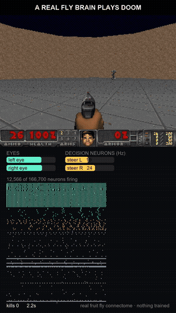

# flyplays: a real fruit fly brain plays games

<p align="center">
  
  
</p>

Scientists mapped every neuron and every connection in a fruit fly's brain: **166,700 neurons, 25.6 million
connections**. `flyplays` runs that map as a spiking network and lets it play games. It plays Flappy Bird, Doom,
a little game made for flies, any web game by its URL, or a game you write yourself.

**Nothing is trained and nothing is scripted.** The game shows up on the fly's own visual neurons. The fly's own
steering and escape neurons press the keys. Everything in between is the real wiring.

```bash
pip install flyplays
flyplays play fruit --clip fruit.mp4
```

The first run downloads the brain (about 260 MB, once). It runs on a normal laptop CPU, faster with a CUDA GPU
(`pip install "flyplays[gpu]"`).

## Is it really the brain?

Fruit Fall, 10 games of 40 seconds each (seeds 101–110):

| the fly | fruit caught per game | survived the swatter |
|---|---|---|
| **as it is** | **6.4** | 6 / 10 |
| blind (it sees nothing) | 1.6 | 1 / 10 |
| left and right outputs crossed | 0.0 | 0 / 10 |

When it sees, it catches four times as much fruit as when it can't. Cross its left and right wires and it catches
nothing at all. The wiring itself is doing the work. Check it yourself: `python examples/06_is_it_really_the_brain.py`.

It's not a good gamer, and that's part of the fun. It usually gets a few pipes in Flappy Bird and a few kills in
Doom, then panics.

## Games

```bash
flyplays list
flyplays play fruit                              # Fruit Fall: catch fruit, dodge the swatter (pure Python)
flyplays play flappy --clip flappy.mp4           # Flappy Bird, on the open-source Floppy Bird site   [web]
flyplays play doom --opt level=e1m1              # Freedoom through ViZDoom                           [doom]
flyplays play my_game:MyGame                     # your own game (see GUIDE.md)
flyplays web <url> --keys left=ArrowLeft,right=ArrowRight,escape=Space --player 0.5,0.85   # any web game  [web]
```

Extras: `pip install "flyplays[web]"`, then `flyplays install-browser` once, for web games. Use
`pip install "flyplays[doom]"` for Doom, or `"flyplays[all]"` for everything.

Useful options:

- `--seed 1-20` plays 20 different games. A seed always replays the same game.
- `--clip out.mp4` films it.
- `--flies 8` makes 8 flies vote. This is best on a GPU.
- `--set threshold=8` changes an interface setting.

## Clips

`--clip` (or `play(..., clip="x.mp4")`) films a 9:16 video at 1080×1920 and 50 fps, ready for TikTok, Shorts
or Reels. The game is on top and the fly's brain is underneath:

- what each eye sees;
- the decision neurons;
- a live strip of spikes from 166,700 neurons.

The clip always plays at the game's real speed, even when the brain thinks slower than real time.

## How the fly plays

```
the game ──► Things (where, how big) ──► the fly's visual neurons ──► 166,700-neuron connectome ──► descending neurons ──► keys
```

**What goes in.** The game describes what's around the player as `Thing`s, each with a bearing and a size. Each
one drives the fly's identified visual neurons on the side it's on. A fly sees almost all the way round.

| kind | neurons | in a real fly |
|---|---|---|
| `target` | LC10a | what a male fly chases |
| `creature` | LC10a, LPLC2, LC4 | chase it while it's in view, looming as it comes closer, fast looming when it's close |
| `shot` | LPLC1 | small objects coming at you |

**What comes out.** Two groups of descending neurons (brain → body) are read as firing rates:

- **steering**: DNa02, DNg111 and DNae002. Left minus right gives `left` or `right`.
- **escape**: DNp01 (the giant fiber), DNp02, DNp04 and DNp11. They give `escape`, which in a real fly is the
  escape jump.

The game turns those three actions into its keys. In Flappy, "turn left" means up, which means flap. In Doom,
an escape burst pulls the trigger.

The only knobs are the interface: how strongly things drive the eye neurons, and how many spikes count as a press
(`flyplays.fly.DEFAULT`). The brain itself is never changed.

## Your own game

A game is a class with six methods: `start`, `tick`, `sense`, `act`, `frame` and `close`. See **[GUIDE.md](GUIDE.md)**
for a step-by-step walk-through, and [`examples/`](examples) for working code:

| example | what it shows |
|---|---|
| `01_quickstart.py` | play a game in 3 lines |
| `02_film_a_clip.py` | play several seeds, film the best |
| `03_my_first_game.py` | a complete new game in about 50 lines |
| `04_any_web_game.py` | any web game, seen through its pixels |
| `05_doom.py` | Doom |
| `06_is_it_really_the_brain.py` | the brain vs blind vs swapped controls |

```python
from flyplays import Game, State, play

class MyGame(Game):
    def start(self, seed): ...
    def tick(self, dt): ...      # move the game on by dt seconds -> State(alive, score)
    def sense(self): ...         # what the fly sees -> [Thing(bearing, size, kind)]
    def act(self, d): ...        # d.left / d.right / d.escape -> your controls
    def frame(self): ...         # the screen as an RGB array (for clips)

print(play(MyGame(), seconds=30, clip="mine.mp4"))
```

## Where the brain comes from

The connectome is MaleCNS v1.0, the complete central nervous system of a male *Drosophila melanogaster*. The
spiking network comes from [`flybrain`](https://pypi.org/project/flybrain/). It's made by
[fly.ai](https://flyaiworld.com), where the same brain also trades from its own wallet.

Web games: only automate games you're allowed to automate, and never games that post to public leaderboards.
The built-in Flappy game plays Nebez Briefkani's open-source [Floppy Bird](https://github.com/nebez/floppybird).
Doom is [Freedoom](https://freedoom.github.io/) through [ViZDoom](https://github.com/Farama-Foundation/ViZDoom).

MIT license.
