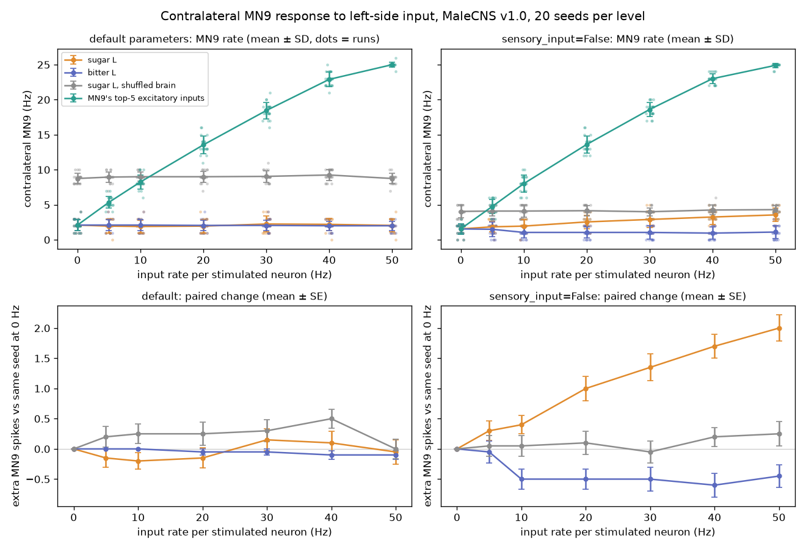
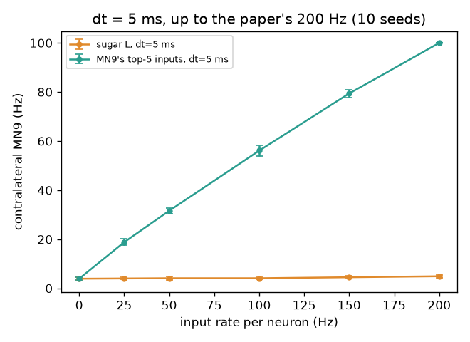

# Sugar to feeding (Shiu et al. 2024) on MaleCNS: results

Notebook: [`sugar_feeding.ipynb`](sugar_feeding.ipynb) (executed, outputs saved). All numbers:
[`sugar_feeding_numbers.csv`](sugar_feeding_numbers.csv). Issue #41.

**Result.** With flybrain's default parameters, driving the MaleCNS sugar GRNs (5–50 Hz) does not change
MN9, and bitter GRNs can't serve as a control because they already fire at their 50 Hz ceiling at rest. With
one documented switch, `sensory_input=False`, the paper's pattern appears in direction: sugar raises MN9 in a
graded way, bitter slightly lowers it, a shuffled brain does nothing. The effect is small, though: +2 Hz at
50 Hz input, against +23 Hz when MN9's own top inputs are driven.

## What Shiu et al. did

Shiu, P.K. et al. *A Drosophila computational brain model reveals sensorimotor processing.* Nature 634,
210–219 (2024). Read in the PMC version (PMC11446845). Facts below cite figures and Methods sections; page
numbers were not checked. Code: [philshiu/Drosophila_brain_model](https://github.com/philshiu/Drosophila_brain_model) at `91bdd1e`.

| | Shiu et al. 2024 | here (flybrain 0.1.1) |
|---|---|---|
| connectome | FlyWire, female brain, 127,400 neurons (materialization 630) | MaleCNS v1.0, male brain + nerve cord, 166,700 neurons |
| neuron model | LIF in Brian2: V_rest = V_reset −52 mV, V_th −45 mV, τ_m 20 ms (from R·C), refractory 2.2 ms, synaptic delay 1.8 ms, synaptic τ 5 ms (Methods, "Computational model") | LIF, 20 ms steps, τ 100 ms, gain 3, tonic 0.14, noise 1.2 Hz × 0.22 V, weights normalised per neuron (`flybrain/brain.py`) |
| free parameter | W_syn = 0.275 mV, set so that 100 Hz sugar input gives ~80% of MN9's maximum (Methods) | none tuned here |
| sugar input | 21 labellar sugar GRNs, one side, Poisson input at 10–200 Hz (Fig. 1d; Methods, "Computational modelling of water and sugar GRN activity") | 17 GRNs (LB3b + LB3c), left side, forced spikes at 0–50 Hz |
| readout | MN9 contralateral to the GRNs, rate over 30 × 1 s runs (Fig. 1c; Methods) | contralateral MN9, spikes over 1 s after 0.5 s settling, 20 seeds |
| bitter | bitter GRNs (21 in the code) inhibit MN9 when added to sugar, and alone do not activate it (Fig. 3a–b) | 19 GRNs (LB1a–d), left side, same rates |
| shuffle | "only 1 of 100" shuffled connectomes activated MN9 at 100 Hz sugar, vs 100% for the real one (Results after Fig. 1; Supplementary Table 1) | one degree-preserving shuffle built in the notebook |

The paper's text gives neither an onset rate for MN9 nor an MN9 rate at a given input rate. Those are in
Fig. 1d (heatmap) and its supplementary data, which I did not extract. The only stated quantity is the
calibration: ~80% of maximum at 100 Hz.

## Mapping

Chain used: Shiu's FlyWire IDs (from their `figures.ipynb`) → FlyWire cell type and modality from
[flywire_annotations](https://github.com/flyconnectome/flywire_annotations) (`Supplemental_file1`, at
`a83b277`) → MaleCNS v1.0 `type`.

What Shiu's lists contain, by later FlyWire typing (20 of 21 IDs in each list still exist at FlyWire
materialization 783):

* sugar list: LB3c ('sugar') ×9, LB3b ('sugar/low_salt') ×2, LB3d ('high_salt/heavy_metal') ×5, LB4b ('putative_attractive') ×4
* bitter list: LB1a ×8, LB1b ×3, LB1c ×4, LB1d ×5 (all 'bitter')
* MN9: FlyWire `CB0701` ('ingestion_motor_neuron')

| FlyWire name (modality) | MaleCNS type | `brain.cell_type` (what `brain.cells` matches) | neurons L | R |
|---|---|---|---|---|
| LB3b (sugar/low salt) | LB3b | `LB3` | 5 | 6 |
| LB3c (sugar) | LB3c | `LB3` | 12 | 11 |
| LB1a (bitter) | LB1a | `LB1a,LB1d` | 6 | 5 |
| LB1b (bitter) | LB1b | `LB1b` | 3 | 3 |
| LB1c (bitter) | LB1c | `LB1c` | 9 | 7 |
| LB1d (bitter) | LB1d | `LB1a,LB1d` | 1 | 4 |
| LB3d (high salt), in Shiu's sugar list | LB3d | `LB3` | 11 | 15 |
| LB4b (putative attractive), in Shiu's sugar list | LB4b | `LB3` | 4 | 4 |
| MN9 = CB0701 | MN9 | `CB0701` | 1 | 1 |

Main sets: **sugar** = LB3b + LB3c (17 per side), **bitter** = LB1a–d (19 per side), **MN9** =
`brain.cells(["CB0701"], side=...)` (body IDs 10331 L, 16949 R).

Could not match, or only partly:

* **Sugar GRNs through `brain.cells`.** The prebuilt `brain.npz` stores the FlyWire match where there is one,
  and MaleCNS matched LB3a/b/c/d and LB4b only to the coarse FlyWire type `LB3`. So `brain.cells(["LB3"])`
  returns 87 neurons of water, sugar, salt and LB4b types together. The notebook selects sugar GRNs by MaleCNS
  body ID (column `type` of the MaleCNS annotation table) instead. Bitter GRNs and MN9 work through
  `brain.cells` (the notebook checks that both routes give the same neurons).
* **"Gr5a" and "Gr66a" themselves.** No connectome labels receptors. The sugar/bitter modality comes from
  FlyWire's annotation of LB types, and MaleCNS's `receptorType` column has no Gr entries. So LB3b + LB3c is
  the best available stand-in for Gr5a GRNs, not a confirmed one.
* **Exact copies of Shiu's 21 neurons.** Their IDs are FlyWire neurons, not MaleCNS ones. Only the types carry
  over. One ID per list no longer exists at FlyWire 783 (sugar `720575940620900446`, bitter
  `720575940618600651`), and one of their two MN9 IDs (`720575940645521262`) has also changed. Shiu's sugar
  list mixes four types, so it is also run as a variant (LB3b + LB3c + LB3d + LB4b, 32 left neurons).

## Method

* **Input.** At each 20 ms step, each stimulated neuron gets `inject` +5 V with probability rate × dt
  (threshold 1 V, so this forces a spike). Levels: 0, 5, 10, 20, 30, 40, 50 Hz; 50 Hz is the ceiling at 20 ms
  steps. Stimulus random numbers come from `default_rng([41, seed])`, the same draws at every level.
* **Trial.** `brain.reset(seed)`, 0.5 s with no input, then 1 s with input. Readout: MN9 spike count over the
  1 s (= Hz). Seeds 0–19 at every level. The 0 Hz level is the zero-input baseline; it is shared by all inputs
  on one brain.
* **Measures.** Contralateral MN9 rate (mean, SD, range); fraction of runs with any MN9 spike; and the paired
  change: count minus the same seed's 0 Hz count (same noise stream), mean ± SE, with a Wilcoxon signed-rank p.
* **Shuffle.** A configuration-model rewiring built in the notebook from the brain's own arrays (`flybrain/`
  not edited). One random permutation of all connections' presynaptic ends (seed 41). Each connection keeps
  its target and size and takes the new source's sign. In-degree, out-degree and each neuron's sign are kept.
  389 self-loops were dropped and repeated pairs merged (25,582,938 → 25,494,871 connections).
* **Positive control.** MN9 R's five strongest excitatory inputs (DNge062, CB0553, CB0493, CB0893, DNge080;
  all left), driven at the same rates.

## Numbers

Contralateral MN9, 20 seeds per level. "Paired change" = extra MN9 spikes in 1 s vs the same seed at 0 Hz,
mean ± SE (Wilcoxon p). Full table, including ipsilateral MN9 and the achieved input rates, in the CSV.

### Default parameters (no parameter changed)

At rest: sugar GRNs 3.0 Hz, **bitter GRNs 50.0 Hz** (the ceiling), MN9 1.8 Hz (L and R).

| input | 0 Hz | 5 | 10 | 20 | 30 | 40 | 50 Hz |
|---|---|---|---|---|---|---|---|
| sugar L: MN9 Hz (mean ± SD) | 2.10 ± 0.79 | 1.95 ± 1.00 | 1.90 ± 0.91 | 1.95 ± 0.94 | 2.25 ± 1.12 | 2.20 ± 0.89 | 2.05 ± 0.94 |
| sugar L: paired change | – | −0.15 ± 0.15 | −0.20 ± 0.14 | −0.15 ± 0.17 | +0.15 ± 0.18 | +0.10 ± 0.19 | −0.05 ± 0.20 (p 0.80) |
| bitter L: MN9 Hz | 2.10 ± 0.79 | 2.10 ± 0.79 | 2.10 ± 0.79 | 2.05 ± 0.76 | 2.05 ± 0.76 | 2.00 ± 0.65 | 2.00 ± 0.65 |
| bitter L: paired change | – | +0.00 | +0.00 | −0.05 ± 0.05 | −0.05 ± 0.05 | −0.10 ± 0.07 | −0.10 ± 0.07 (p 0.42) |
| sugar L, shuffled brain: MN9 Hz | 8.75 ± 0.72 | 8.95 ± 0.76 | 9.00 ± 0.65 | 9.00 ± 0.79 | 9.05 ± 0.83 | 9.25 ± 0.79 | 8.75 ± 0.72 |
| sugar L, shuffled: paired change | – | +0.20 ± 0.17 | +0.25 ± 0.16 | +0.25 ± 0.19 | +0.30 ± 0.18 | +0.50 ± 0.15 | +0.00 ± 0.16 (p 1.0) |
| MN9's top-5 inputs: MN9 Hz | 2.10 ± 0.79 | 5.35 ± 0.81 | 8.25 ± 1.02 | 13.55 ± 1.28 | 18.45 ± 1.19 | 22.90 ± 1.02 | 25.00 ± 0.32 |
| LB3b+c+d+LB4b L: paired change | – | −0.15 ± 0.13 | +0.10 ± 0.18 | +0.25 ± 0.14 | +0.25 ± 0.14 | +0.55 ± 0.18 | +0.70 ± 0.15 (p 0.0009) |
| sugar R → MN9 L: paired change | – | +0.10 ± 0.12 | +0.30 ± 0.13 | +0.20 ± 0.16 | +0.40 ± 0.15 | +0.50 ± 0.14 | +0.55 ± 0.22 (p 0.03) |

Fraction of runs where MN9 fired at all: 0.80–1.00 in every row of this table (0.65–1.00 with
`sensory_input=False`; per row in the CSV), because MN9 fires from noise at ~2 Hz. So it can't tell
conditions apart, and the paired change is the measure to read. The bitter GRNs' achieved rate is 50 Hz at every level, so the bitter sweep
adds no input.

### `sensory_input=False` (one parameter changed; the table above is "before")

At rest: sugar GRNs 0.3 Hz, bitter GRNs 0.2 Hz, MN9 2.2 Hz L / 1.6 Hz R.

| input | 0 Hz | 5 | 10 | 20 | 30 | 40 | 50 Hz |
|---|---|---|---|---|---|---|---|
| sugar L: MN9 Hz (mean ± SD) | 1.55 ± 0.76 | 1.85 ± 0.75 | 1.95 ± 0.89 | 2.55 ± 0.94 | 2.90 ± 1.17 | 3.25 ± 1.07 | 3.55 ± 0.94 |
| sugar L: paired change | – | +0.30 ± 0.16 (p 0.12) | +0.40 ± 0.15 (p 0.03) | +1.00 ± 0.21 (p 0.0006) | +1.35 ± 0.22 (p 0.0002) | +1.70 ± 0.19 (p 9e-5) | +2.00 ± 0.22 (p 8e-5) |
| sugar L: runs above matched 0 Hz run | – | 0.35 | 0.40 | 0.65 | 0.80 | 0.90 | 0.95 |
| bitter L: MN9 Hz | 1.55 ± 0.76 | 1.50 ± 1.05 | 1.05 ± 0.83 | 1.05 ± 0.83 | 1.05 ± 0.94 | 0.95 ± 0.89 | 1.10 ± 0.91 |
| bitter L: paired change | – | −0.05 ± 0.18 | −0.50 ± 0.17 (p 0.016) | −0.50 ± 0.17 (p 0.016) | −0.50 ± 0.20 (p 0.035) | −0.60 ± 0.20 (p 0.015) | −0.45 ± 0.18 (p 0.038) |
| sugar L, shuffled brain: MN9 Hz | 4.05 ± 0.89 | 4.10 ± 0.72 | 4.10 ± 0.85 | 4.15 ± 0.75 | 4.00 ± 0.56 | 4.25 ± 0.72 | 4.30 ± 0.57 |
| sugar L, shuffled: paired change | – | +0.05 ± 0.17 | +0.05 ± 0.17 | +0.10 ± 0.19 | −0.05 ± 0.18 | +0.20 ± 0.16 | +0.25 ± 0.20 (p 0.25) |
| MN9's top-5 inputs: MN9 Hz | 1.55 ± 0.76 | 4.75 ± 1.02 | 8.00 ± 1.21 | 13.60 ± 1.19 | 18.60 ± 0.99 | 23.00 ± 0.73 | 24.90 ± 0.31 |

### `dt=0.005` (one parameter changed, otherwise default; 10 seeds)

Lets input reach the paper's 100–200 Hz.

| input | 0 Hz | 25 | 50 | 100 | 150 | 200 Hz |
|---|---|---|---|---|---|---|
| sugar L: MN9 Hz | 3.9 ± 0.57 | 4.0 ± 0.47 | 4.1 ± 0.74 | 4.1 ± 0.32 | 4.5 ± 0.53 | 4.9 ± 0.57 |
| sugar L: paired change | – | +0.10 ± 0.23 | +0.20 ± 0.25 | +0.20 ± 0.20 (p 0.62) | +0.60 ± 0.22 (p 0.06) | +1.00 ± 0.26 (p 0.016) |
| MN9's top-5 inputs: MN9 Hz | 3.9 ± 0.57 | 18.8 ± 1.32 | 31.6 ± 1.17 | 56.1 ± 2.23 | 79.4 ± 1.58 | 100.0 ± 0.00 |

With `sensory_input=True` the sugar GRNs' achieved rate is above the nominal one (e.g. 40 Hz at nominal
25 Hz), because sensory neurons also excite each other.

### Where the sugar signal goes

Default brain, 50 Hz sugar input: **116 neurons** respond reliably (mean ≥ +1 spike and higher in at least 18
of 20 seeds). 76 of them are one synapse from the sugar GRNs, 38 are two away and 2 are three away. The
strongest are SEZ local neurons (GNG215, GNG228, GNG038, GNG452, GNG232, GNG254 ...), other labellar GRNs
(LB3d, LB2d, reached through GRN–GRN synapses) and the descending neuron DNg67. MN9 is two synapses from the
sugar GRNs but is not among the responders.

## Plots





## Comparison with the paper

| question | Shiu et al. (FlyWire) | MaleCNS, default | MaleCNS, `sensory_input=False` |
|---|---|---|---|
| does sugar drive MN9? | yes; ~80% of max at 100 Hz by calibration | no (5–50 Hz); +1 Hz at 200 Hz with dt = 5 ms | yes in direction, weakly: +2 Hz at 50 Hz (MN9 can reach 25 Hz) |
| from what input rate? | not stated in the text (Fig. 1d) | – | first significant at 10 Hz (+0.4, p 0.03), clear from 20 Hz |
| does bitter drive MN9? | no; bitter suppresses sugar-driven MN9 | not testable (bitter GRNs saturated at rest) | no; slight suppression of spontaneous MN9 (−0.5 Hz) |
| shuffled connectome | 1 of 100 shuffles activates MN9 | no sugar effect | no sugar effect |
| contralateral MN9 | contralateral > ipsilateral (Fig. 1c) | – | contralateral +2.00 vs ipsilateral +1.05 at 50 Hz |

Where MaleCNS agrees: the sign of the sugar effect and bitter effect, the contralateral bias, and the null
result on a shuffled brain, all with `sensory_input=False`. Where it differs: the size of the effect (small
against what MN9 can do), and with the default `sensory_input=True` the pathway doesn't show at all.

## Limits

* The models differ in more than the connectome. flybrain uses 20 ms steps, no synaptic delay or time
  constant, inputs normalised per neuron, and tonic drive plus noise; its parameters were set on visual
  escape and steering. Shiu et al. tuned their one free parameter on this sugar → MN9 readout. A weak response
  here is a statement about this model on this connectome, not about the fly.
* Sugar GRNs are identified by FlyWire morphological type and modality (LB3b/LB3c), not by receptor
  expression. Shiu's mixed composition (LB3b+c+d+LB4b) does a little better on the default brain (+0.70 at
  50 Hz vs −0.05 for LB3b+c), but is still small.
* Input is forced spikes at a set probability per step, not Brian2 Poisson synaptic input. The +5 V kick size
  is a choice; it only needs to exceed threshold.
* One shuffle (degree-preserving, seed 41), not 100, and not the paper's shuffle method.
* `sensory_input=False` and `dt=0.005` were each tried once, as one-parameter changes. Nothing was searched or
  tuned. The bitter + sugar co-activation of the paper's Fig. 3a was not run.
* The untested idea that the saturated bitter GRNs (and other sensory loops) mask the sugar effect in the
  default brain fits the before/after difference but was not tested on its own.
* Results are bit-identical on a rerun on the same machine. numba's parallel sum depends on the thread count,
  so a machine with a different number of threads may give different individual spikes (the statistics
  should hold).

## Rerun

Hardware: Apple M4 (10 cores, 10 numba threads), 16 GB, macOS 27.2.1, CPU only. Python 3.11.14,
flybrain 0.1.1 (PyPI), numpy 2.4.6, scipy 1.17.1, numba 0.68.1, pandas 3.1.1, pyarrow 26.0.1,
matplotlib 3.11.2. Runtime: about 8 minutes for the whole notebook (7.6, 7.9 and 8.1 min on three runs), plus
about a minute for the first-time downloads.

```bash
python3.11 -m venv venv && source venv/bin/activate
pip install flybrain pandas pyarrow matplotlib nbconvert ipykernel
flybrain download          # ~260 MB into ~/fly-data (or $FLY_DATA)
cd notebooks
jupyter nbconvert --to notebook --execute --inplace sugar_feeding.ipynb --ExecutePreprocessor.timeout=3600
```

The notebook also downloads the MaleCNS annotation table (14.5 MB) and the FlyWire annotations (31.7 MB) into
`$FLY_DATA/annotations`. Seeds: brain noise `reset(seed)` with seeds 0–19 (0–9 for dt = 5 ms); stimulus
`default_rng([41, seed])`; shuffle `default_rng(41)`. `SUGAR_SEEDS=2` in the environment gives a quick
smoke run.

Coding agent: Claude Code (Claude Opus 5.5).
